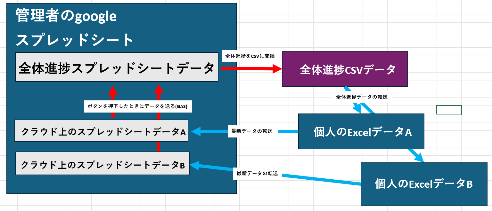

# Excel進捗管理ツール　 Excelで他人の進捗状況を確認できるようにしました。

---------

機能画像

---------

## ※重要事項※

 - Excelの名称は個人シート（id)にしてください。（例：個人シート１) 変更した場合、データの送信を行えません。

 - Excel内の機能を使うために、Excelマクロの使用を許可してください。

---------

### 主要な機能

・送信ボタンを押すことで、自身の進捗を全体データに送る

・受信ボタンを押すことで、全体データをExcelシートに持ってこれる

---------

### 動作環境

Excelが動作する環境であること

• OS: Windows 11 または Windows 10

• CPU: 1.6 GHz またはそれ以上の速度、2コア

• メモリ: 4 GB 以上（32ビット版の場合は 2 GB 以上）

• 画面解像度: 1280 x 768 ピクセル以上

• グラフィックス: DirectX 9 以上

管理者がgoogleワークスペースのgoogleスプレッドシートを利用可能であること

---------

### 使用上の条件

・管理者が個人用のシートの名称を指定して配布をお願いします。

・管理者が利用者にデータを配布する際に、説明書を同封してください。

・管理者が更新をしない限り、全体進捗は更新されません。

・管理者はGoogleスプレッドシートからデータ更新を手動で行ってください。

---------

### 使い方

・作業進捗管理シートにある送信ボタンを押すことで、自身の進捗を、管理者が保有しているgoogleワークスペースの個人シートに送信します。

・全体進捗シートにある受信ボタンを押すことで、管理者が更新した全体進捗をコピーし、全体進捗シートにペーストします。
